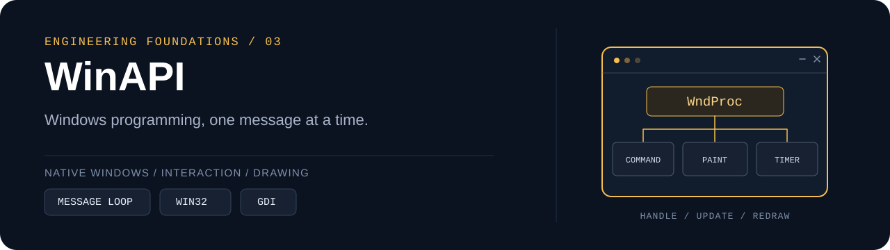

# WinAPI

`C / C++` · `Win32 API` · `GDI` · `Visual Studio` · `Coursework`

Windows 프로그래밍 수업의 과제와 실습을 모은 저장소입니다.
기본 창과 메시지 처리에서 시작해 텍스트 입력, 애니메이션, 대화상자, 컨트롤과 맵 편집을 다룹니다.
각 예제는 학습 주제별로 분리되어 있으며, 하나의 완성된 제품이나 통합 애플리케이션을 뜻하지 않습니다.

[Selected exercises](#selected-exercises) · [Repository map](#repository-map) · [Build & run](#build--run) · [Regression check](#regression-check)

## Learning focus

- **Message-driven UI** — `WinMain`, 메시지 루프와 `WndProc`의 역할을 연결합니다.
- **Input & state** — 키보드·마우스 입력을 상태 변경과 화면 갱신으로 이어 봅니다.
- **Drawing & timing** — GDI 그리기, 비트맵, 타이머와 프레임 갱신을 실습합니다.
- **Native controls** — 대화상자 리소스, 버튼·편집 컨트롤·목록과 명령 메시지를 다룹니다.

## Selected exercises

| Exercise | 살펴볼 내용 | Source |
| --- | --- | --- |
| Basic Window | 창 클래스 등록, 메시지 루프와 기본 창 프로시저 | [BasicWindow.cpp](BasicWindow/Project1/BasicWindow.cpp) |
| Multiline Input | 10줄 × 30자 입력, Enter·Backspace, 줄별 출력과 캐럿 | [BasicWindow.cpp](Weeks04-05/Project2/Project2/BasicWindow.cpp) |
| Sprite Animation | 타이머 기반 프레임 갱신, 캐릭터 상태와 장애물 이동 | [5-8.cpp](WinAPI_animation/WinAPI_animation/5-8.cpp) |
| Dialog Controls | 경로 선택, 색상·이동 옵션과 대화상자 메시지 처리 | [6-2.cpp](WinAPI_DialogBox/WinAPI_DialogBox/WinAPI_DialogBox/6-2.cpp) |
| Calculator | 대화상자 입력, 사칙연산과 진법 전환 | [6-3.cpp](calculating%20machine/calculating%20machine/6-3.cpp) |
| Child Window | 자식 캔버스, 편집·목록·버튼 컨트롤과 타이머 | [7-1.cpp](Child%20window/Child%20window/7-1.cpp) |
| Map Tool | 15 × 15 격자, 타일 배치·지우기와 플레이 테스트 | [7-2.cpp](map%20tool/map%20tool/7-2.cpp) |

## Repository map

```text
WinAPI/
├── BasicWindow/          # 기본 창 실습
├── Week01/              # C 기초 실습
├── Week03/              # 초기 Windows 프로그래밍 실습
├── Weeks04-05/          # 텍스트 입력과 도형 실습
├── Week07/              # 주차별 실습과 리소스
├── Week08/              # 주차별 실습과 이미지 자산
├── WinAPI_animation/    # 타이머·이미지 애니메이션
├── WinAPI_DialogBox/    # 대화상자와 컨트롤
├── calculating machine/ # 계산기 실습
├── Child window/        # 자식 창과 UI 컨트롤
├── map tool/            # 격자 맵 편집 실습
├── Practice/
│   ├── MidtermReview/   # 보드 실습 복습
│   └── WindowTemplate/  # 소스가 비어 있는 시작용 템플릿
└── tests/               # 텍스트 입력 회귀 검사
```

파일명은 영어로, 설명과 학습용 주석은 한국어로 작성합니다.
기존 폴더명과 실습 번호를 유지해 수업 자료·프로젝트 설정과 대응할 수 있게 했습니다.

## Build & run

1. Windows에서 Visual Studio의 **C++를 사용한 데스크톱 개발**과 Windows SDK를 준비합니다.
2. `.slnx`를 지원하고 **MSVC v145** 도구셋을 사용할 수 있는 환경에서 원하는 솔루션을 엽니다.
3. 시작 예제로 [BasicWindow/Project1.slnx](BasicWindow/Project1.slnx)를 선택합니다.
4. 해당 프로젝트를 시작 프로젝트로 지정하고 `Debug | x64` 구성을 확인한 뒤 실행합니다.

현재 포함된 16개 `.vcxproj`의 `PlatformToolset`은 모두 `v145`입니다.
설치된 도구셋이 다르면 필요한 구성 요소를 설치하거나, 해당 프로젝트의 속성을 확인해 다시 대상을 지정하세요.
이미지를 사용하는 예제는 상대 경로로 자산을 찾으므로 프로젝트 폴더 구조와 실행 작업 디렉터리를 유지해야 합니다.

### Select one exercise at a time

한 프로젝트에 독립적인 `WinMain`을 가진 여러 `.cpp`가 함께 들어 있는 경우가 있습니다.
여러 예제를 동시에 빌드하면 진입점이나 전역 심볼이 중복될 수 있습니다.

- 실행할 소스는 **파일 속성 → 구성 속성 → 일반 → 빌드에서 제외 = 아니요**로 설정합니다.
- 나머지 독립 예제는 **빌드에서 제외 = 예**로 설정합니다.
- 다른 구성으로 바꿀 때도 소스와 리소스의 제외 설정을 확인합니다. 일부 프로젝트는 `Debug | x64`에만 선택 설정이 있습니다.
- `Weeks04-05/Project2`는 모든 구성에서 `BasicWindow.cpp`를 선택하고 다른 예제는 보관합니다.

[Practice/WindowTemplate](Practice/WindowTemplate/)은 빈 템플릿입니다.
`WindowTemplate.cpp`가 비어 있고 프로젝트에 컴파일할 소스가 등록되어 있지 않으므로, 실행 가능한 예제로 취급하지 않습니다.
창 진입점과 소스를 작성·등록한 뒤 사용하세요.

## Regression check

[tests/BasicWindowInputTests.cpp](tests/BasicWindowInputTests.cpp)는 `Weeks04-05/Project2`의 실제 `HandleCharacter` 함수를 검사합니다.
빈 입력 삭제, 30자 제한, 줄 이동, 마지막 줄 경계, 널 종료와 ASCII 입력 정책을 다룹니다.
이 검사는 해당 입력 로직의 회귀 검사이며 전체 GUI·모든 실습의 실행 검증을 대신하지 않습니다.

저장소 루트에서 **x64 Native Tools Command Prompt**를 열고 실행합니다.

```bat
cl /nologo /EHsc /utf-8 /DUNICODE /D_UNICODE tests\BasicWindowInputTests.cpp /Fe:BasicWindowInputTests.exe user32.lib gdi32.lib /link /SUBSYSTEM:CONSOLE
BasicWindowInputTests.exe
```

## Related repositories

- [Data-Structure](https://github.com/sanu1227/Data-Structure) — C++ 자료구조 구현과 실습
- [Computer-Graphics](https://github.com/sanu1227/Computer-Graphics) — 그래픽스 프로그래밍 과제와 실습

---

실습별 구현과 프로젝트 설정을 함께 읽으며, 입력·상태·메시지·그리기의 연결을 살펴보는 학습 기록입니다.
